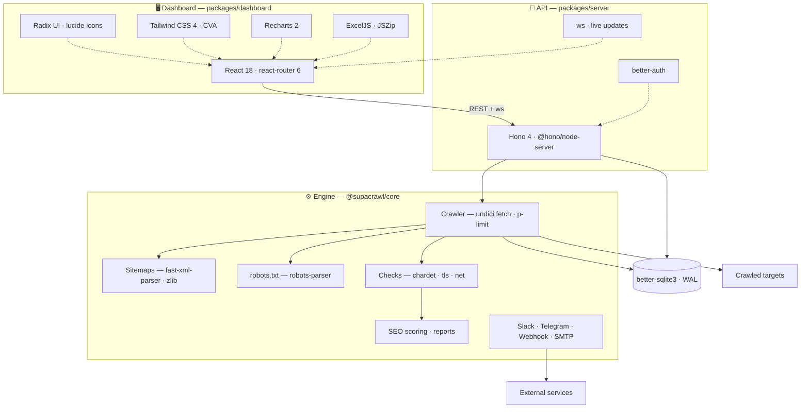

# SupaCrawl

Sitemap-based website monitoring with DDoS-safe crawling, uptime monitoring, and
change detection. Monorepo with core, server, and dashboard packages.

## Features

- **Crawl jobs** — scheduled sitemap crawls that check every URL for broken links
  (4xx/5xx), content changes, SSL expiry, and mojibake.
- **Uptime monitors** — interval-based HTTP checks with retries, heartbeat
  history, uptime stats, and response-time graphs.
- **SEO checker** — inspect any URL to preview how it renders on Google and
  major social networks, review extracted meta/Open Graph/Twitter tags, get a
  Lighthouse-style SEO score with fix recommendations, and check page weight.
- **Notifications** — Slack, Telegram, Email, and Webhook alerts on crawl
  failures, content changes, SSL expiry, and monitor down/recovery.
- **Dashboard** — web UI for managing jobs and monitors, browsing URL history,
  and reviewing per-crawl reports (Excel .xlsx export).

## Requirements

- Node.js >= 22
- pnpm

## Quick start

```bash
pnpm install

# Start the API + dashboard (serves both on :3456)
pnpm dev:server
```

Open `http://localhost:3456`. If no users exist yet, you'll be redirected to the
setup page to create your first admin account.

For hot-reload dashboard development on port 5173 (proxying to the server on 3456):

```bash
pnpm dev:dashboard
```

## Configuration

Settings live in `supacrawl.config.json` (see `supacrawl.config.example.json`).
Admin UI options (crawler limits, checks, notifications, registration) are
managed from the Settings page.

Environment variables:

| Variable | Description |
|---|---|
| `BETTER_AUTH_SECRET` | Secret for signing auth cookies |
| `BETTER_AUTH_URL` | Public URL of the app (used for auth links) |
| `BETTER_AUTH_TRUSTED_ORIGINS` | Comma-separated origins allowed to use auth |
| `GITHUB_CLIENT_ID` / `GITHUB_CLIENT_SECRET` | Optional GitHub social login |
| `PORT` / `HOST` | Server bind settings (default `3456` / `0.0.0.0`) |

## Tech stack



A single SQLite database (WAL mode) is shared by the server and the crawl
engine — no external services beyond the notification targets themselves.
Shared foundation: TypeScript 5.6 (strict, ESM), Node >= 22, pnpm workspaces,
tsup builds, Vitest.

## Development

```bash
pnpm dev          # run server and dashboard in parallel
pnpm build        # build all packages
pnpm typecheck    # typecheck all packages
pnpm test         # run vitest suites
```

## Docker

```bash
docker compose up -d
```

The image serves the dashboard and API on port `3456` and persists the SQLite
database in the `supacrawl-data` volume. Set `BETTER_AUTH_SECRET` before first
start.

## Structure

```
packages/
  core/        Shared types, storage (SQLite), crawler, notifier, monitor scheduler
  server/      Hono HTTP server, auth, API routes, dashboard hosting
  dashboard/   React + Vite web app
```
